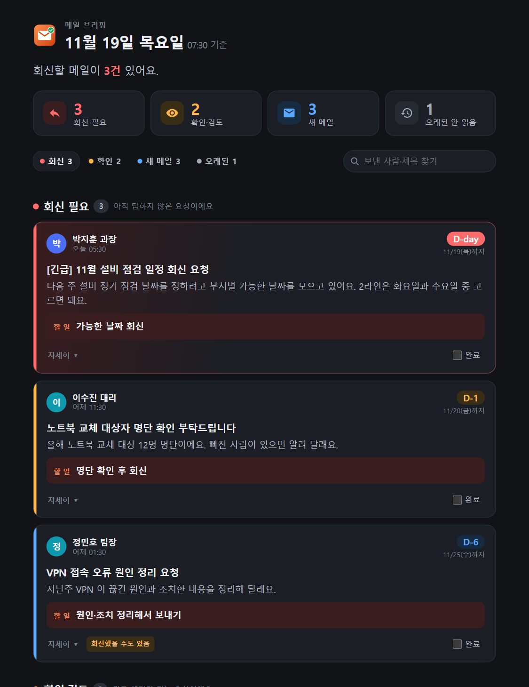
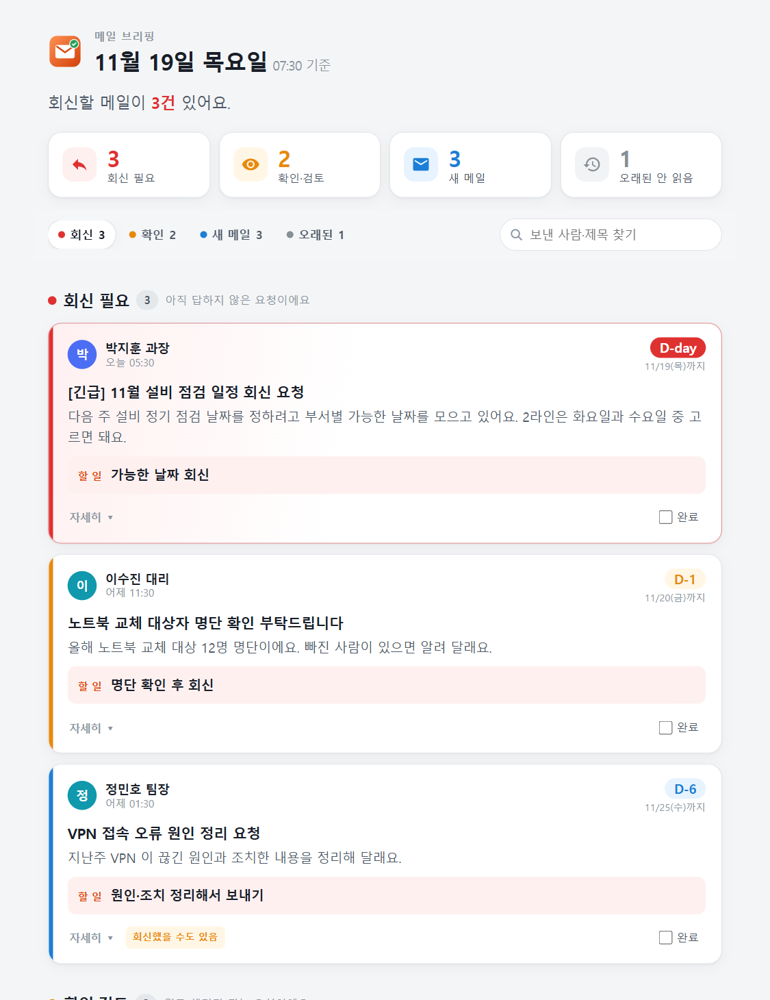
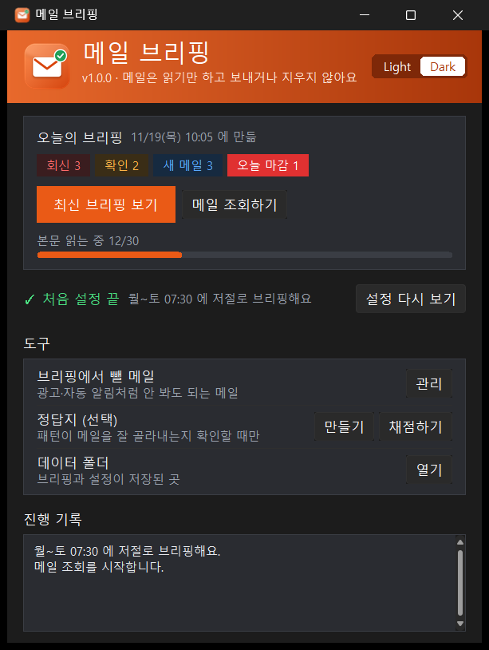
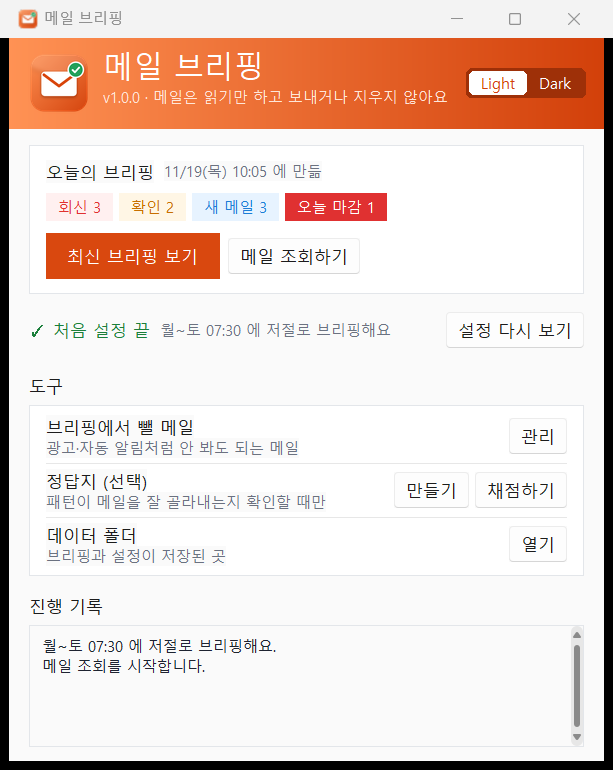

<div align="center">


# 메일 브리핑

**아침마다 그룹웨어 메일을 대신 읽고, 오늘 챙길 메일만 카드로 정리해 주는 Windows 프로그램**


-222222)


</div>

- 월~토 07:30 에 저절로 실행되고, Windows 알림을 누르면 브리핑이 열립니다.
- **회신할 메일 · 확인할 메일 · 새로 온 메일**을 나눠서, 기한이 급한 순서로 보여 줍니다.
- 하루 중간에도 설정 창의 **메일 조회하기** 로 언제든 새로 만들 수 있습니다.
- 메일은 **읽기만** 합니다. 보내거나 지우거나 옮기지 않고, 읽느라 '읽음'이 된 메일은 다시 '안 읽음'으로 돌려놓습니다.
- 요약은 PC 안의 로컬 AI 가 합니다. **메일 내용은 PC 밖으로 나가지 않습니다.**

> 화면 사진의 메일과 숫자는 모두 가상입니다.

## 화면

### 브리핑

| 다크 (기본) | 라이트 |
|:---:|:---:|
|  |  |

- **급한 순서 색 띠**: 오늘 마감은 빨강, 1~2일 남으면 주황, 더 남으면 파랑
- **자세히**: 요약 전체와 '왜 요청으로 봤는지' 근거 문장
- **위 메뉴 · 검색**: 칸으로 바로 가기, 보낸 사람·제목·요약으로 찾기
- **완료 체크 · 답장 · 메일 보기**: 처리한 메일은 접어 두고, 답장 쓰기 화면을 바로 열기

### 설정 창

| 다크 (기본) | 라이트 |
|:---:|:---:|
|  |  |

- 맨 위 **Light | Dark** 로 테마 전환 (브리핑도 같은 색으로)
- **오늘의 브리핑**: 회신·확인·새 메일 개수와 오늘 마감 표시
- 메일 조회 중에는 **진행 막대**로 지금 단계(로그인 → 목록 → 본문 → 요약)를 보여 줌
- 처음 설정(계정 → 로그인 시험 → AI 준비 → 자동 실행 → 첫 조회)이 끝나면 한 줄로 접힘

## 하는 일

```
작업 스케줄러 (월~토 07:30)
  → ① 로그인        Playwright 로 Edge 를 창 없이 띄워 그룹웨어에 접속
  → ② 메일 모으기    받은편지함 14일치 + 보낸편지함 (회신했는지 확인용)
  → ③ 판정          나에게 온 요청인지, 회신/검토 중 무엇인지, 기한은 언제인지 (패턴 규칙)
  → ④ 요약          PC 안의 로컬 AI (Ollama, qwen3:4b) 가 한 줄 요약
  → ⑤ 브리핑        HTML 카드 화면 (완료 체크, 답장, 메일 보기 버튼)
  → ⑥ 알림          Windows 알림
  → ⑦ 되돌리기      본문을 열어 '읽음'이 된 메일을 '안 읽음'으로 복구하고 확인
```

## 안전 원칙

- **비밀번호**는 이 PC 의 Windows 자격 증명 관리자에만 저장합니다.
- **메일 요약**은 이 PC 안의 로컬 AI 가 합니다. 메일 내용은 PC 밖으로 나가지 않습니다.
- **에러 보고(Sentry)** 에는 에러 종류와 실패한 단계만 갑니다. 메일 제목·본문·보낸 사람은 보내지 않습니다 (`monitoring.py` 에서 허용 목록으로 거름).
- 메일 정보가 있어야 고칠 수 있는 에러는 Sentry 대신 이 PC 안의 진단 파일에만 남깁니다.
- 실제 메일, 정답지, 브리핑은 `%LOCALAPPDATA%\mailbrief` 와 `data/` 에만 있고 git 에 올리지 않습니다.

## 폴더 구성

```
mail-briefing/
├── src/mailbrief/            프로그램 본체
│   ├── cli.py                명령어 입구 (run, wizard, cleanup, --profile 등)
│   ├── wizard.py             설정 창 (exe 를 더블클릭하면 뜨는 창)
│   ├── ui.py                 창 모양: Windows 11 테마, 글꼴 크기, 다크 모드, 아이콘
│   ├── runner.py             브리핑 한 번 실행 (①~⑦ 순서대로)
│   ├── groupware.py          그룹웨어 자동화: 로그인, 목록·본문 읽기, 안 읽음 복구 (Playwright)
│   ├── collect.py            브리핑 재료 모으기 (14일치, 사내 시스템 알림 메일 구분)
│   ├── classify.py           요청·회신/검토·기한·이미 회신했는지 판정 (패턴 규칙)
│   ├── summarize.py          로컬 AI(Ollama) 요약
│   ├── cache.py              읽은 본문과 만든 요약 저장 (다음 날엔 새 메일만 읽음)
│   ├── briefing.py           브리핑 HTML: 세 칸 카드, 완료 체크, 답장 링크, 뺄 메일 목록
│   ├── notify.py             Windows 알림
│   ├── system.py             작업 스케줄러 등록, 그래픽카드 확인, Ollama 설치 도우미
│   ├── credentials.py        그룹웨어 계정 저장 (Windows 자격 증명 관리자)
│   ├── config.py             설정 읽기 (.env 의 회사 값, 화면 테마, 시험 프로필별 데이터 폴더)
│   ├── monitoring.py         Sentry 연결과 업무 내용 거르기
│   ├── diagnostics.py        메일 정보가 필요한 에러를 PC 안에만 저장
│   ├── answers.py            실제 메일 정답지(엑셀) 만들기
│   ├── scoring.py            정답지 채점 (맞은 개수만 셈)
│   ├── compare.py            요약 모델 블라인드 비교
│   ├── __init__.py           버전 번호
│   └── assets/               아이콘 (icon.ico, icon.png, icon-64.png)
├── tests/                    자동 테스트 (실제 메일은 쓰지 않음)
│   ├── test_classify.py      가상 메일로 판정 규칙 채점
│   ├── test_briefing.py      뺄 메일 목록 비교
│   ├── test_briefing_render.py  브리핑 화면 조립 (급한 정도 띠, 개수, 검색어)
│   ├── test_scrub.py         Sentry 로 업무 내용이 새지 않는지 확인
│   └── fixtures/             가상 메일 61통 + 따로 떼어 둔 확인용 25통
├── docs/images/              README 화면 사진 (가상 메일)
├── tools/
│   └── make_icon.py          프로그램 아이콘 그리기
├── build_exe.py              배포용 exe 빌드 + zip 만들기 (읽어주세요.md 내용도 여기)
├── CHANGELOG.md              버전별 바뀐 점 (zip 에는 바뀐점.md 로 들어감)
├── pyproject.toml            패키지 정보와 의존성
├── uv.lock                   의존성 버전 고정
├── .env.example              .env 견본 (Sentry DSN, 그룹웨어 주소 같은 회사 값)
└── .gitignore                .env, data/, dist/ 등 올리지 않을 것
```

## 쓰는 도구

| 도구 | 쓰는 곳 |
|---|---|
| Python 3.14 + uv | 언어, 패키지 관리 |
| Playwright (Edge) | 그룹웨어 자동 조종 |
| Ollama (qwen3:4b) | PC 안에서 돌아가는 요약 AI |
| Sentry | 에러 보고, 아침 실행 감시(Crons), 버전별 기록 |
| tkinter + sv-ttk | 설정 창 |
| keyring | 비밀번호 보관 |
| winotify | Windows 알림 |
| openpyxl | 정답지 엑셀 |
| PyInstaller | exe 로 묶기 |
| pytest | 자동 테스트 |

## 개발 환경

```powershell
uv sync                      # 의존성 설치
copy .env.example .env       # SENTRY_DSN, GROUPWARE_URL 등 채우기
uv run mailbrief             # 설정 창 열기
uv run mailbrief run         # 브리핑 한 번 실행
uv run pytest                # 테스트
```

| 명령 | 하는 일 |
|---|---|
| `mailbrief` / `mailbrief wizard` | 설정 창 열기 |
| `mailbrief run` | 브리핑 실행 |
| `mailbrief setup` | 그룹웨어 계정 입력 |
| `mailbrief answers export` / `score` | 실제 메일 정답지 만들기 / 채점 |
| `mailbrief compare` | 요약 모델 블라인드 비교 |
| `mailbrief sentry-test` | Sentry 거르기 확인 |
| `mailbrief --profile 이름 ...` | 다른 사람 계정 시험용 (계정·데이터를 따로 둠, 자동 실행 없음) |
| `mailbrief --profile 이름 cleanup` | 시험 프로필의 데이터와 계정 지우기 |

## 배포

```powershell
uv run python build_exe.py   # dist\메일브리핑_v{버전}.zip 생성
```

- zip 안에는 `메일브리핑.exe`, `읽어주세요.md`(설치 안내), `바뀐점.md`(CHANGELOG) 가 들어갑니다.
- 받는 사람은 압축을 풀어 원래 폴더에 덮어쓰면 됩니다. 계정과 설정은 그대로 남습니다.
- 브라우저는 Windows 기본 Edge 를 쓰므로 따로 넣지 않습니다.
- 그룹웨어 주소 같은 회사 값은 코드에 없고, 빌드할 때 `.env` 에서 읽어 exe 안에만 넣습니다.

## 버전 규칙

`큰 변경 . 기능 추가 . 작은 수정` (시맨틱 버저닝). 지금은 **1.0.0** (첫 최종본) 입니다. 바뀐 내용은 [CHANGELOG.md](CHANGELOG.md) 에 있습니다.
